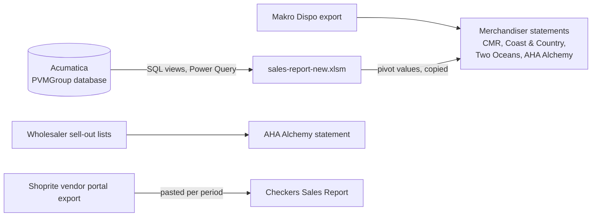
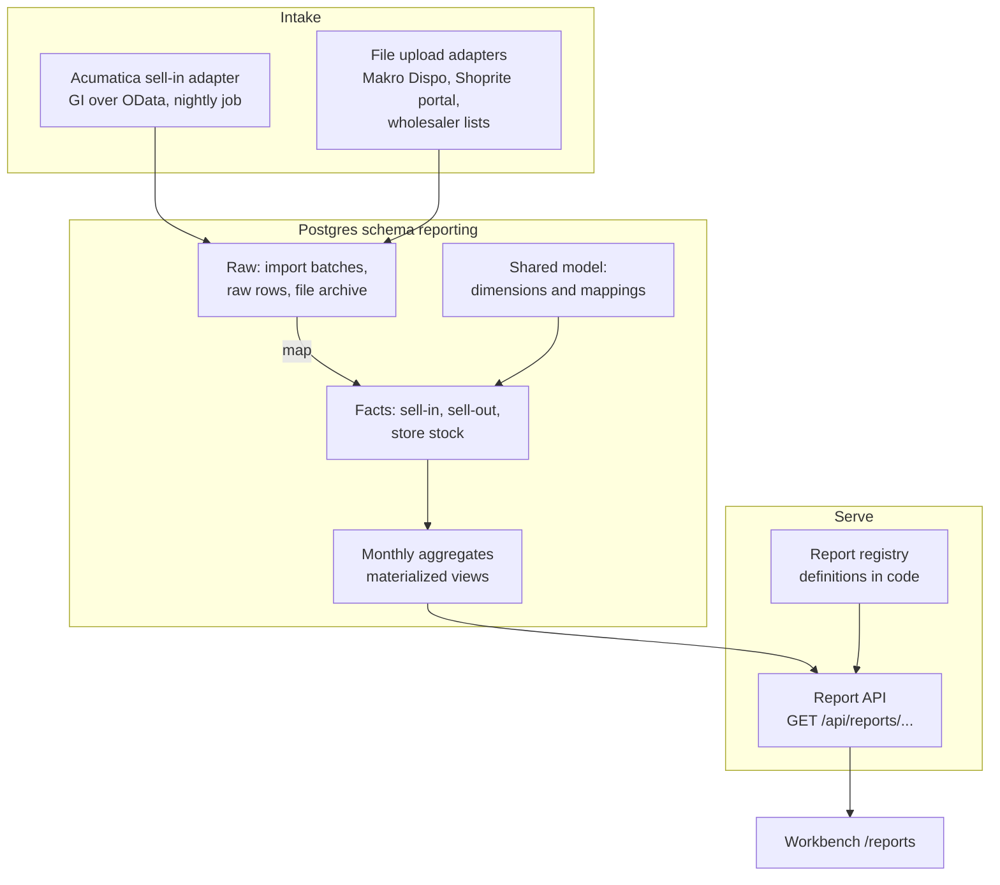

# Reports: analysis and architecture proposal

Status: proposal for discussion · Lane: Reports · 2026-11-12

This document examines the sales report and seven related files that PVM uses
today. It then proposes a reports module for the workbench, which later reports
can join. Nothing is built yet. The owner reviews this proposal before the build
starts.

Data rules for this document:

- It contains sheet names, column names, counts and made-up example values only.
- It contains no row of customer or sales data, and no credential.
- The source files stay outside the repository.

Contents:

1. [Summary](#1-summary)
2. [The main sales report](#2-the-main-sales-report)
3. [The seven other files](#3-the-seven-other-files)
4. [How the files connect](#4-how-the-files-connect)
5. [Proposed architecture](#5-proposed-architecture)
6. [Workbench surfaces](#6-workbench-surfaces)
7. [Build order](#7-build-order)
8. [Open questions for the owner](#8-open-questions-for-the-owner)

---

## 1. Summary

- **The main report does not use the Acumatica API.** It runs one SQL query
  against the SQL Server database `PVMGroup` on port 1433. The query reads two
  custom views, `dbo.FinYearSales_adr` and `dbo.LastYearSales_adr`. The
  integration guide forbids this path for the backend. The workbench must read
  the same data through a Generic Inquiry (GI) over OData, or through the
  contract-based REST API.
- **The views are the business rules.** The SQL only groups and sums. The rules
  for document types, amounts, rep, province and "type of good" are inside the
  two views. We do not have their definitions. This is open question 1.
- **The report is one dataset with five pivots.** All visible report sheets read
  one table of 741 459 monthly rows. Four pivots show amount or quantity by rep
  or by product, across the financial months. One hidden pivot counts distinct
  customers.
- **The merchandiser reports are made by PVM.** Four of the seven files are
  monthly statements for merchandiser companies. Each one is a copy of pivot
  values from the main report, plus Makro store sales, plus a commission or
  retainer line.
- **The raw reports come from retailers and wholesalers.** These are the Makro
  "Dispo" export, the Shoprite group vendor portal export, and wholesaler
  sell-out lists. They report sales at store level, which Acumatica does not
  have.
- **Two kinds of fact.** Acumatica gives *sell-in* (PVM invoices to a customer).
  The retailer files give *sell-out* (units sold in a store) and store stock. A
  shared model with one product, customer, store, rep and period dimension lets
  the two meet.
- **Proposal.** A reports module with source adapters, a staging store, a shared
  model in Postgres, report definitions in code, and generic report surfaces.
  A new report adds a definition, and sometimes an adapter. It does not add a
  new pipeline.

---

## 2. The main sales report

File: `sales-report-new - 2026.xlsm`, 107 MB. The size comes from the data: the
same 741 459 rows are stored three times (the sheet `SalesData`, the worksheet
pivot cache and the Power Pivot data model).

### 2.1 Sheets

| Sheet | State | Content | Size |
| --- | --- | --- | --- |
| `Client Count` | Hidden | Pivot on the data model: distinct count of `DebtorName`, rows `RepName`, columns `FinYear2` and `FinMonth` | 26 rows × 99 columns |
| `Sheet1` | Visible | Table `Table1`: a drill-down extract of `SalesData` (22 columns) | 2 435 rows |
| `Products (quantity)` | Visible | Pivot: sum of `Quantity`, rows `ItemGroupName` > `ItemDescription` > `RepName`, columns `FinYear2` > `FinPeriod` (months). Five slicers | 38 rows × 14 columns |
| `Sheet2` to `Sheet8` | Visible | Tables `Table2` to `Table9`: more drill-down extracts of `SalesData` | 2 to 235 rows each |
| `Sales Rep (amount)` | Visible | Pivot: sum of `Amount`, rows `RepName` > `CustomerGroup` > `DebtorName`, columns `FinYear2` > months. Page filters `ItemGroupName`, `Warehouse`, `ItemDescription`. Three slicers | 179 rows × 21 columns |
| `Sales Rep (quantity)` | Visible | Pivot: sum of `Quantity`, rows `Warehouse` > `ItemGroupName` > `ItemDescription`, columns `FinYear2` > months. Six page filters. Four slicers | 387 rows |
| `Products (amount)` | Visible | Pivot: sum of `Quantity` (the sheet name says amount), rows `ItemDescription` > `CustomerGroup` > `DebtorName`, columns `FinYear2` > months, four financial years. Four page filters. Five slicers | 1 146 rows × 47 columns |
| `lookups` | Hidden | Two lookup lists: customer group to channel (31 rows), and calendar month to financial period, year offset and month label (12 rows) | 32 rows |
| `SalesData` | Visible | Table `SalesData`: the query result, plus six formula columns | 741 459 rows × 22 columns |

The workbook has no charts. Its drawings hold only slicers. The VBA project
has four macros, and each macro selects one sheet (`view_amount`,
`view_quantity`, `view_pr_amount`, `view_pr_quantity`). The VBA contains no
data logic and no connection.

### 2.2 Filters

There are 17 slicers on five fields, and up to six page filters per pivot.

| Field | Distinct values | Used as |
| --- | --- | --- |
| `Channel` | 3 | Slicer on four sheets |
| `FinYear2` | 9 | Slicer on four sheets |
| `RepName` | 31 | Slicer, page filter |
| `Province` | 13 | Slicer on three sheets |
| `ItemGroupName` | 8 | Slicer, page filter |
| `ItemDescription` | 289 | Slicer, page filter |
| `Warehouse` | 16 | Page filter |
| `TypeofGood` | 9 | Page filter |
| `TransactionType` | 2 (invoice, credit memo) | Page filter |
| `CustomerGroup` | 70 | Page filter |
| `DebtorName` | 3 403 | Page filter |

### 2.3 Measures, periods and comparisons

- Measures: sales amount, sales quantity, distinct customers.
- Period: the financial month. The financial year runs from March to February.
  `FinYear2` is the calendar year plus 1 for March to December. Example: March
  2026 is month 1 of financial year 2027.
- Comparison: side by side financial years. Each year has 12 month columns and a
  year total. There is no growth percentage in the main report.
- Data range: calendar years 2018 to 2026, financial years 2019 to 2027.

### 2.4 Data source

| Item | Finding |
| --- | --- |
| Power Query | One query, `SalesData`. It calls `Sql.Database(<server>, "PVMGroup", [Query=...])` |
| SQL | `SELECT ... GROUP BY` on `dbo.FinYearSales_adr`, `UNION ALL` the same on `dbo.LastYearSales_adr` |
| Grain of the result | Rep, province, customer group, customer, item group, item, view financial year, transaction type, warehouse, type of good, calendar year, calendar month |
| Connections | `Query - SalesData` (Power Query), `ModelConnection_ExternalData_2` and `ThisWorkbookDataModel` (the embedded data model), one worksheet connection |
| Credential | The file contains no password, user name or key. Excel keeps the SQL Server credential in the data source settings of each user's computer. The server address is in the M code. |
| File location | A personal OneDrive folder of the sales team |

Columns from SQL, with the Acumatica data that they most likely come from. The
"likely source" column is a hypothesis. Only the view definitions can confirm it.

| Column | Meaning | Likely Acumatica source |
| --- | --- | --- |
| `RepName` | Sales rep | Salesperson (`SalesPerson`) on the document or the customer |
| `Province` | Province code | State of the customer or ship-to address |
| `CustomerGroup` | Customer group | Customer class (`CustomerClass`) |
| `DebtorName`, `DebNo` | Customer name and ID | `Customer` |
| `ItemGroupName` | Product group | Item class (`ItemClass`) |
| `ItemDescription` | Product | `StockItem` description |
| `FinYear` | Financial year from the view | Financial period of the document |
| `TransactionType` | Invoice or credit memo | AR document type |
| `Warehouse` | Warehouse name | `Warehouse` on the line |
| `TypeofGood` | Finished goods, short-dated, promotion, damaged and others | Unknown: a warehouse location, an item attribute or a reason code |
| `SalesAmount`, `SalesQuantity` | Sum of line amount and quantity | AR transaction lines |

Formula columns that Excel adds to each row:

| Column | Formula, in words |
| --- | --- |
| `FinYear2` | Calendar year plus the year offset from `lookups` |
| `Amount`, `Quantity` | Copies of `SalesAmount` and `SalesQuantity`, forced to numbers |
| `Channel` | `CustomerGroup` looked up in `lookups`, else "Other" |
| `FinMonth` | Month label from `lookups` |
| `FinPeriod` | First day of the month, with `FinYear2` as the year |

### 2.5 Defects in the current report

The workbench version must not copy these defects.

1. `ClientCount` is always 1. The SQL counts distinct customers inside a group
   that already contains the customer. The pivot uses a distinct count from the
   data model instead, which is correct.
2. Two financial-year definitions exist: `FinYear` from the view (2020 to 2027)
   and `FinYear2` from Excel (2019 to 2027). The pivots use `FinYear2`.
3. The channel lookup has 31 entries for 70 customer groups. All other groups
   become "Other". One lookup key has a stray character at the end, so it never
   matches.
4. The `Client Count` pivot sorts months as text (Apr, Aug, Dec), not in
   financial order.
5. The sheet `Products (amount)` shows quantity.
6. Three copies of the data make the file 107 MB.

---

## 3. The seven other files

### 3.1 Classification

| File | Set | Made by | Grain | Rows |
| --- | --- | --- | --- | --- |
| `Makro Dispo Report PVM 05112026.xls` | Raw report | Makro (an SAP "Dynamic List Display" export) | Site × article × order unit, 6 monthly columns | 3 926 rows, 47 sites, 16 articles |
| `vnd-art-sas_11-11-2026_….xlsx` | Raw report | Shoprite group vendor portal ("Vendor Article Sales and Stock") | Site × article, 6 monthly columns, with stock | 3 919 rows, 503 sites, 10 articles |
| `Checkers Sales Report.xlsx` | Merchandiser report (store sell-out per PVM rep) | PVM | Site × article × month | 116 958 rows, 510 sites, 10 articles, 13 reps, 38 months |
| `CMR PVM Oct 2026.xlsx` | Merchandiser report (statement) | PVM, for merchandiser company CMR Meridian | Month × customer group × customer or store | One month |
| `CoastCountry Oct 2026.xlsx` | Merchandiser report (statement) | PVM, for Coast & Country | Month × customer group × customer or store | One month |
| `TWO OCEANS KZN Oct 2026.xlsx` | Merchandiser report (statement) | PVM, for Two Oceans Marketing | Month × customer group × customer or store, and a year-on-year sheet | One month, plus 3 months × 2 years |
| `AHA ALCHEMY May - Sep 2026.xlsx` | Merchandiser report (statement), with raw reports inside | PVM, for Alchemy Agency. Raw sheets from pharmacy wholesalers | Period × wholesaler, and invoice lines | 11 sheets, Feb 2025 to Sep 2026 |

### 3.2 Raw reports

#### Makro Dispo report

- Format: tab-separated text with an `.xls` name. Excel opens it, but it is not
  an Excel file. The first line is the run date and the title. The header is on
  line 4.
- Key columns: `Vendor`, `Vendor Name`, `Vendor Prod Code`, `Article`,
  `Article Desc`, `Barcode`, `BMC`, `Order Unit`, `UOM`, `Compo`, `Site`,
  `Site Name`, `Status`, `RP`.
- Measures: units for six months (`06-2026` to `11-2026`), the same month last
  year (`11-2025`), `Curr Y/S`, stock on hand (`SOH`), stock on order (`SOO`),
  stock in transit (`SIT`), `MAC`, `List Price`, `Net Cost`, `Incl SP`,
  `Prom SP`, margins.
- One article has one row per unit of measure: each (`EA`), case (`CS`),
  shrink wrap (`SW`), layer (`LAY`), pallet (`PAL`) and `**`. Each unit has its
  own barcode. Sales sit on the `EA` and `**` rows. Example: article
  `100000001`, UOM `EA`, barcode `6000000000001`.
- Mapping to PVM: `Barcode` on the `EA` row is the GTIN of the PVM product.
  `Vendor Prod Code` is a short PVM code. `Site` is the Makro store code.
  Makro is one customer group in Acumatica, so the store level exists only in
  this file.

#### Shoprite group vendor portal ("vnd-art-sas")

- Format: Excel, made by the portal on request. The file name holds the request
  date and a random key.
- Sheets: `Parameter Selection`, `Consolidated View`, `Consolidated by P.Org`
  (by purchasing organisation, which is a region), `Separate View` (by store),
  `Vendor and VSR Total View`.
- Key columns in `Separate View`: `Site` (code and name, for example
  `0001-EXAMPLE STORE`), the category levels, `Article Key`, `Article`,
  `PL Label 4` (pack size), `Sell UOM`, `Orderable UOM`, `RP Type`, `Lstd`,
  `Stk`, `Ord Blk`, `Active Stores`.
- Measures: `Sell Price (Incl)`, units for six months, `Total Sales Units`,
  `Curr ROS` (rate of sale), `Latest Period Sales (Excl)`, `Stock Value @MAC`,
  `Stock Qty`, `WOS` (weeks of stock), dates last sold, ordered and received,
  and `DC Stock`.
- The file has no GTIN. `Article Key` is the Shoprite article number. The
  backend already maps Shoprite items to Acumatica items in
  `ShopriteItemMappingEntity` (`ShopriteBuyerItemId`, `Gtin`,
  `AcumaticaInventoryId`). We must confirm that `Article Key` is the same
  number as `ShopriteBuyerItemId`.
- This is a sales and stock report. It is not an order, and an upload of it
  does not read or change Shoprite orders.

#### Wholesaler sell-out lists (inside the AHA Alchemy file)

Five sheets hold invoice lines from pharmacy wholesalers to pharmacies, for
February to April 2025. Each wholesaler uses its own columns:

| Sheet | Key columns |
| --- | --- |
| `TOPMED Feb - Apr` | `ACCOUNT`, `NAME`, `TRANS NO`, `DATE`, `PRODUCT`, `DESCRIPTION`, `QTY`, `SALES TOTAL`, `SALESREP` |
| `CJ Jan - April` | `Suppacnt`, `Suppdiv`, `Date`, `ACCOUNT`, `NAME`, `SALESREP`, `CODE`, `DESCR`, `PQTY`, `UPRICEEX`, `VALUE` |
| `Alpha Pharm Feb-Apr` | `ITEM_NUMBER`, `DESCRIPTION`, `NAPPI_CODE`, `BAR_CODE`, `INV_DATE`, `INV_NUMBER`, `QUANTITY_INVOICED`, `EXTENDED_AMOUNT`, `PARTY_NAME` and more |
| `Arrie Nel Feb-April` | `CUSTOMER NAME`, `INV NO.`, `DATE`, `PRODUCT`, `DESCRIPTION`, `QTY`, `SALES TOTAL`, `SALESREP` |
| `Van Heerdens Feb - Apr` | A pivot from the PVM sales report, not a raw list |

Only Alpha Pharm gives a barcode (GTIN). The others use their own product code,
so each wholesaler needs a code-to-product map.

### 3.3 Merchandiser reports

#### Checkers Sales Report

- PVM made this workbook. Each period sheet (`Oct24-Mar25` to `Apr-Sept 2026`)
  is a pasted copy of a vendor portal export. The column layout changes between
  periods, because the portal changed.
- `data-sales` (table `checkers`) turns the period sheets into one long list:
  `Site Key`, `Site`, `Sales Rep`, `Article Key`, `Article`, `Bar Type`,
  `Cost Price`, `Period`, `Sales`, `Value`.
- Formula columns: `Site Key` is the first four characters of `Site`.
  `Sales Rep` comes from the store-to-rep table `reps`. `Bar Type` is "45g" or
  "Bitesize", from the article name. `Value` is `Sales` × `Cost Price`.
- `lookups` (table `reps`): `SAPStoreNumber`, `StoreName`, `PVM REP`, 596 stores.
- `Stores per rep`: the Shoprite store list with `StoreNumberWithCheckDigit`,
  `Brand`, `SAPStoreNumber`, `StoreName`, `GLNCode`, address, `Division`,
  `Region` and trading status. This is a store master with GLNs.
- `PIVOT`: sum of `Value` by `Sales Rep` > `Site`, by year and month.
- The "Sales Rep" here is a PVM field merchandiser per store. The workbook does
  not show if this list is the same as `RepName` in Acumatica.

#### Statements for merchandiser companies (CMR, Coast & Country, Two Oceans, AHA Alchemy)

All four follow one pattern:

1. **Summary**: sales per customer group for the month, by region, a grand
   total, then a commission line (a percentage of the total) or a fixed
   retainer line.
2. **Detail**: customer group, then each customer or store under it, with the
   month amount. The layout matches the `Sales Rep (amount)` pivot of the main
   report: `FinYear2` and month in the header, and in one file a `RepName` as the
   top row.
3. **Makro**: "Sum of Rand value" per Makro store for the month. The store names
   match the `Site Name` of the Makro Dispo report.
4. Two Oceans only: **DISCHEM sales**, Dis-Chem stores for three months in two
   financial years, with a growth percentage per store.
5. AHA Alchemy only: one sheet per statement period, and the raw wholesaler
   lists for the first period.

The detail sheets hold values only. The only formulas are the totals and the
commission. A person makes each statement by hand from the main report and the
Makro file.

---

## 4. How the files connect

| Merchandiser report | Uses |
| --- | --- |
| CMR PVM | Main report (sell-in by customer group and store), Makro Dispo |
| Coast & Country | Main report, Makro Dispo |
| Two Oceans KZN | Main report (also the Dis-Chem year-on-year sheet), Makro Dispo |
| AHA Alchemy | Main report (customer group of the pharmacy distributors), wholesaler sell-out lists |
| Checkers Sales Report | Shoprite vendor portal exports, the store-to-rep list |

Identifiers that join the sources:

| Join | From | To | Key |
| --- | --- | --- | --- |
| Product | Makro Dispo | PVM product | GTIN on the `EA` row |
| Product | Shoprite portal | PVM product | `Article Key` through the Shoprite item mapping |
| Product | Alpha Pharm | PVM product | `BAR_CODE` (GTIN) |
| Product | Other wholesalers | PVM product | Wholesaler product code, needs a map |
| Store | Shoprite portal | Shoprite store master | First four characters of `Site` = `SAPStoreNumber` |
| Store | Makro Dispo | Makro store | `Site` code |
| Store | Merchandiser statements | Acumatica customer | `DebtorName`. Many Acumatica customers are stores, for example a Dis-Chem or Pick n Pay branch |
| Rep | Store master | PVM merchandiser | Store-to-rep list |

---

## 5. Proposed architecture

### 5.1 Principles

1. **One pipeline, many reports.** A report is a definition over the shared
   model. It is not a separate import job.
2. **Read Acumatica through the API.** Use a Generic Inquiry over OData or the
   contract-based endpoint, as the integration guide requires. Do not use
   SQL Server port 1433.
3. **Keep the raw input.** Store every uploaded file and every API page as
   received, with a hash. A defect in a parser can then be fixed and the input
   loaded again.
4. **Map once, show the gaps.** Unmapped products and stores go to a "Needs
   attention" list. A report never drops a row without a count of what it
   dropped.
5. **The same numbers as Excel first.** The first release must match the current
   workbook per financial month and rep, before anybody stops using the workbook.

### 5.2 Layers

The module follows the existing backend layers:

| Layer | Project | New content |
| --- | --- | --- |
| Domain | `Pvm.Domain/Reporting` | Period and financial-year rules, identifier schemes, report definition types |
| Application | `Pvm.Application/Reporting` | Import commands, mapping service, report query service, report registry |
| Infrastructure | `Pvm.Infrastructure/Reporting` | Acumatica GI client, file parsers, EF Core entities and migrations, SQL for aggregates |
| API | `Pvm.Api/Features/Reports` | Report endpoints, import endpoints, CSV export |
| Jobs | Container Apps job, as for the Investec feed | `job-pvm-sales-sync`, nightly |
| Workbench | `frontend/workbench/app/reports` | Index, report pages, imports, mappings |

### 5.3 Data intake

#### Acumatica sell-in

- Build one Generic Inquiry, for example `PVM-Sales-Lines`, on AR transaction
  lines (`ARTran`) joined to the document, customer, customer class,
  salesperson, address, stock item, item class and warehouse. Publish it to
  OData. Grain: one row per invoice or credit memo line.
- Fields: document type and number, document date, financial period, customer
  ID and name, customer class, salesperson, province, inventory ID,
  description, item class, warehouse, "type of good", quantity, amount in base
  currency without VAT, last modified time.
- Read by financial period (a string filter, which works), not by date. The
  guide records that a date filter returns HTTP 500. Always set `$top`, and
  page.
- Window: each night, read the current and previous financial period. Each
  week, read the whole open financial year. Credit memos can land in an old
  period. A configuration value sets a floor date.
- Rebuild the rules of `FinYearSales_adr` in the GI and in the domain code. Then
  run a parity check against the workbook, per financial month and rep, before
  the switch.
- The integration user needs view rights on the GI and on the screens behind it.
  Probe each entity first, then ask once, as the guide describes.
- Alternative: the contract-based entity `SalesInvoice` with `$expand=Details`.
  It needs no customisation, but it returns more data and fewer joined fields.
  The GI is the better match for a report.

#### File uploads

- One Task page, "Import sales file", for all retailer and wholesaler files.
- Each file format has an adapter. The adapter recognises the file by its header
  signature, not by its name. Examples: the Makro Dispo title line and header,
  or the "Vendor Article Sales and Stock" title.
- The adapter returns: the source, the period covered, the row count, and the
  unmapped products and stores. The user checks this before the import.
- An import replaces the earlier data of the same source and period. Example: a
  Shoprite export for May to October replaces those six months.
- The raw file goes to the payload archive that the backend already has.
- Adapters in the first release: Makro Dispo, Shoprite vendor portal. Later:
  each pharmacy wholesaler, and Dis-Chem if a portal file exists.

#### Reference data

| Data | Source today | Proposal |
| --- | --- | --- |
| Customer group to channel | Hidden `lookups` sheet | A settings table, edited in the workbench |
| Financial calendar | Hidden `lookups` sheet | Domain code: year starts in March |
| Shoprite store master, with GLN | `Stores per rep` sheet | Imported once, then maintained in the workbench |
| Makro store list | Makro Dispo `Site`, `Site Name` | Created from the first import |
| Store to PVM merchandiser | `lookups` in the Checkers file | A mapping table with "valid from" and "valid to" dates |
| Merchandiser company: area, customers, stores, commission rate or retainer | In the heads of the people who make the statements | A settings table per company, with dates |

### 5.4 Shared model

Dimensions:

| Dimension | Key | Main attributes |
| --- | --- | --- |
| `period` | Calendar month | Calendar year and month, financial year (March to February), financial month number, label |
| `product` | Acumatica inventory ID | Description, item class, pack type (45 g bar, bite size and others) |
| `product_identifier` | Scheme and value | Scheme (GTIN, Shoprite article, Makro article, NAPPI, wholesaler code), unit of measure, pack factor, link to `product` |
| `customer` | Acumatica customer ID | Name, customer class, channel, province, salesperson |
| `store` | Retailer and store code | Name, GLN, province, region, retailer, link to `customer` where PVM invoices the store directly |
| `rep` | Rep ID | Name, kind (Acumatica salesperson, PVM merchandiser, merchandiser company) |
| `assignment` | Store or customer, rep, dates | Who covers what, and when |

Facts:

| Fact | Grain | Measures | Source |
| --- | --- | --- | --- |
| `sell_in_line` | Acumatica document line | Quantity, amount excluding VAT | Acumatica |
| `sell_out_month` | Store × product × month | Units, value (where the source gives it) | Retailer and wholesaler files |
| `store_stock_snapshot` | Store × product × snapshot date | Stock on hand, on order, in transit, DC stock, weeks of stock | Retailer files |

Aggregates:

- `sell_in_month`: sell-in summed to the grain of today's `SalesData`. The sales
  report reads this materialized view. It is refreshed after each load.
- `sell_out_month_by_rep`: sell-out with the store-to-rep assignment applied.

Size: today's 741 459 monthly rows, and an estimated few million document lines
for eight years. Postgres handles this with plain indexes on period, customer
and product. No separate analytics database is necessary.

### 5.5 Report definitions

A report is a definition in backend code. The report registry holds the list.
A definition gives:

- An ID, a title, a description and the roles that can open it.
- The fact or aggregate that it reads.
- The filters, each with its dimension and its default (for example, the current
  financial year).
- The measures (sum of amount, sum of quantity, distinct customers, growth
  against last year).
- One or more views: row dimensions, column dimension (usually the financial
  month), and the totals.
- The export formats (CSV first, Excel later).

The report API is generic. `GET /api/reports/{id}?view=by-rep&finYear=2027&channel=Retail`
returns the column headers, the rows with their levels, and the totals. The
server does the grouping in SQL, so the browser never receives 741 459 rows. A
new report is a new definition, and most new reports need no new endpoint.

### 5.6 Refresh schedule

| Source | When | How |
| --- | --- | --- |
| Acumatica sell-in | Each night at 04:00 SAST, after the day's invoices | Container Apps job, current and previous financial period |
| Acumatica sell-in, full year | Each Sunday | Same job, whole open financial year |
| Acumatica, on request | When an Admin presses "Refresh now" | Same command path as the job |
| Shoprite vendor portal | Each month, after month end | Upload by a person |
| Makro Dispo | Each week or each month (to confirm) | Upload by a person |
| Wholesaler lists | When received | Upload by a person |
| Aggregates | After each load | Refresh of the materialized views |

Each report shows the time of the last good load for each of its sources.

---

## 6. Workbench surfaces

The redesign plan puts Reports under "Insight" at `/reports`, for all roles. C7
now plans one report (statement coverage by account) with CSV export, and a
`Sparkline` and a column chart. The sales report needs C7 to grow as follows.

### 6.1 Pages

| Route | Template | Content |
| --- | --- | --- |
| `/reports` | Dashboard | One `Tile` per report, with the freshness of its sources. `AttentionList`: unmapped products and stores, failed loads, sources older than expected |
| `/reports/sales` | Dashboard | Module overview of the sales report. `TabNav`: Overview, By rep, By product, Customers, Data. `StatTile`s: sales this financial year to date, against last year, active customers. A column chart by financial month, this year against last year |
| `/reports/sales/by-rep` | List, with a pivot grid | Replaces `Sales Rep (amount)` and `Sales Rep (quantity)`. Rows rep > customer group > customer. A `Tabs` switch between amount and quantity |
| `/reports/sales/by-product` | List, with a pivot grid | Replaces `Products (amount)` and `Products (quantity)`. Rows item group > product > customer group or rep |
| `/reports/sales/customers` | List, with a pivot grid | Replaces `Client Count`. Distinct customers by rep and financial month, in financial order |
| `/reports/sales/data` | List | The rows behind the report, with filters and CSV export. Replaces the drill-down sheets `Sheet1` to `Sheet8` |
| `/reports/merchandisers` | List | One row per merchandiser company and month, with total sales and commission |
| `/reports/merchandisers/[id]` | Record | One statement: summary by region and customer group, detail by store, Makro by store, commission. Export to Excel |
| `/reports/sell-out` | Dashboard | Store sell-out: Shoprite group by PVM merchandiser and store, Makro by store, stock and weeks of stock |
| `/reports/imports` | List | Every file import and Acumatica load, with source, period, rows and status |
| `/reports/imports/new` | Task | "Import sales file": choose file, check what will change, import, done |
| `/reports/mappings` | List | Unmapped and mapped product identifiers and stores, with a "Map item" action |

### 6.2 Filters

The workbook has five slicers. The design system allows at most four fields in a
`FilterBar`. Proposal:

- `FilterChips` for `Channel` (3 values and "All").
- `FilterBar` with financial year, rep, province and item group.
- The product filter is on the By product tab only.
- Filters live in the URL, as the design system requires, so a filtered report
  can be shared as a link.

### 6.3 New components

The design system must get these components before the report pages use them.
Each one goes into `src/ui`, into `design-system.md` and into `/ui-kit` in the
same pull request:

| Component | Why |
| --- | --- |
| `PivotGrid` | `DataTable` allows 7 columns. A report needs 12 months, a total and, for a comparison, two years. The grid needs a sticky first column, row levels that open and close, subtotal rows, a totals row and column, and figures in tabular numbers |
| `ColumnChart` | Monthly values, this year against last year. Already planned for C7 |
| `Sparkline` | A trend inside a `StatTile` or a grid row. Already planned for C7 |
| `FreshnessBadge`, or a new `StatusBadge` value | "Data to 11 Nov, 04:00", with a warning tone when a source is late |

No chart library: the redesign document forbids one. `ColumnChart` and
`Sparkline` are small SVG components.

---

## 7. Build order

| Slice | Content | Done when |
| --- | --- | --- |
| R0 | Owner answers the open questions. Get the view definitions. | The rules of the two views are written down |
| R1 | Shared model, `period` and financial-year rules, GI in QA, sell-in job, raw store | QA has the same monthly totals per rep as the workbook, for two financial years |
| R2 | Report registry and API, `PivotGrid`, `/reports`, `/reports/sales` with its tabs, CSV export | The sales report pages show the same numbers as the workbook |
| R3 | File import framework, Makro and Shoprite adapters, store master, mappings page | October files import with no unmapped rows |
| R4 | Merchandiser companies and assignments, statement pages, Excel export | The October statements match the four hand-made files |
| R5 | Sell-out dashboard, wholesaler adapters, Dis-Chem year on year | Agreed after R4 |

Production use starts after R2, in parallel with the workbook for one month.

---

## 8. Open questions for the owner

### Data source

1. Who owns the SQL views `FinYearSales_adr` and `LastYearSales_adr`, and can we
   get their definitions? They hold the rules for document types, amounts (with
   or without VAT and discounts), rep, province and "type of good".
2. Do you agree to replace the direct SQL connection with a Generic Inquiry over
   the API? This means a GI in the production Acumatica, and view rights for the
   integration user.
3. Which financial year is correct: `FinYear` from the view, or `FinYear2` from
   Excel? They differ by one year for part of the data.
4. How many years of history must the workbench hold? The workbook starts in
   2018.
5. Must the port 1433 access stay open for this workbook after the switch? The
   integration guide recommends to close it.

### Users and access

6. Who uses the sales report? Must a rep see only their own customers?
7. Do the merchandiser companies get a login, or only an exported file?
8. Do you need the drill-down sheets (`Sheet1` to `Sheet8`), or is a filtered
   data list with CSV export enough?

### Merchandiser statements

9. For each merchandiser company: which customer groups, stores and provinces
   does it cover, and from which date?
10. What is the commission rule for each company (a rate or a retainer), and who
    approves a statement before it goes out?
11. How is "Sum of Rand value" for Makro calculated? The Makro Dispo file gives
    units, and several prices (`Net Cost`, `List Price`, `Incl SP`, `MAC`).
12. Are the Dis-Chem figures in the Two Oceans file from Acumatica, or from a
    Dis-Chem file?

### Raw reports

13. How often do you download the Makro Dispo and the Shoprite portal files, and
    who does it?
14. Is `Article Key` in the Shoprite portal export the same number as the
    Shoprite buyer item ID in the existing item mappings?
15. Which "Cost Price" does the Checkers report use to calculate `Value`, and
    who keeps it up to date?
16. Are the PVM merchandisers in the Checkers report ("Sales Rep") the same
    people as the Acumatica salespeople (`RepName`)?
17. Do you still get the wholesaler sell-out lists (Topmed, CJ, Alpha Pharm,
    Arrie Nel)? Must the workbench import them?

### Scope

18. Which surface comes first after the sales report: the merchandiser
    statements, or the store sell-out dashboard?
19. Are sales targets or budgets needed in a later report? The current files
    have none.
20. Do you accept that C7 in the redesign plan grows from one report to the
    module in this document? If yes, the redesign document gets an update in
    slice R2.
