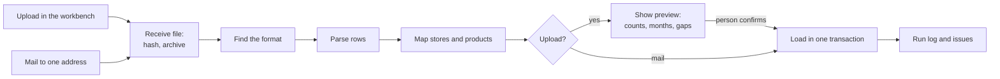

# Design: sell-out import for retailer and wholesaler files (R2)

Status: draft for goal R2, step 1.

Source of the decision: the owner chose "one import, files by upload or mail,
for now" (board decision `reports-sellout-route`, 2026-11-18). No retailer gives
sales or stock data by API. Refer to the board report "Retailer sales data".

This design builds on the file analysis in `docs/design/reports-analysis.md`,
sections 3 to 5 (PR #65). All example values in this document are made up.

---

## 1. Scope

In scope:

- One import for sell-out files. Sell-out is the number of units that a store
  or a wholesaler sold to its own customers.
- Three file formats:
  1. Makro "Dispo" report.
  2. Shoprite group vendor portal report "Vendor Article Sales and Stock"
     (`vnd-art-sas`). It covers Checkers, Shoprite and Usave stores.
  3. Pharmacy wholesaler invoice lists: TopMed, CJ, Alpha Pharm and Arrie Nel.
- Two ways in: an upload in the workbench, and a file that a person sends to
  one mail address.
- Store stock from the retailer files, as a snapshot on the file date.

Out of scope for R2:

- Reports and dashboards on sell-out. They come in a later goal.
- The merchandiser statements. They are the next build after the sales report.
- Dis-Chem. PVM has no Dis-Chem file yet. Dis-Chem shares data through NIQ
  Activate.
- Any read or change of Shoprite orders. The `vnd-art-sas` file is a sales and
  stock report, not an order.

---

## 2. The three file formats

| Item | Makro Dispo | Shoprite `vnd-art-sas` | Wholesaler lists |
| --- | --- | --- | --- |
| Format | Tab-separated text with an `.xls` name. Header on line 4 | Excel. Sheet `Separate View`, header on row 7 | Excel, one sheet per wholesaler, one header row |
| How to know the format | Line 4 has `Vendor`, `Article`, `Barcode`, `Site`, `SOH` | Row 1 is `Vendor Article Sales and Stock` | The header names of each wholesaler (section 2.3) |
| Grain | Site × article × order unit | Site × article | Invoice line |
| Months | 6 columns `MM-YYYY`, plus the same month last year | 6 columns `Mmm YYYY units` | The invoice date of each line |
| Measures | Units. Stock on hand, on order, in transit | Units. Stock quantity, stock value, weeks of stock, DC stock | Units and value |
| Product key | `Barcode` on the `EA` row (GTIN) | `Article Key` (Shoprite article number) | Alpha Pharm: `BAR_CODE` (GTIN). Others: own code |
| Store key | `Site` code and `Site Name` | `Site`, for example `0012-EXAMPLE STORE` | The pharmacy name or account |
| File date | Line 1 (run date) | `Parameter Selection`: `Date requested` | None. The upload date |

### 2.1 Makro Dispo

- One article has one row for each unit of measure: each (`EA`), shrink wrap
  (`SW`), case (`CS`), layer (`LAY`), pallet (`PAL`) and `**`. Each row gives
  its units, stock and `Net Cost` in its own unit. `Compo` is the number of
  single items in that unit, for example 20 for a shrink wrap.
- Sales and stock are spread over the rows. Example: the shrink wrap row holds
  most of the units and the stock on hand, and the case row holds the stock on
  order. The parser therefore adds all rows of a site and an article:
  - units in single items = Σ (units × `Compo`).
  - value = Σ (units × `Net Cost`).
  - stock in single items = Σ (stock × `Compo`), for `SOH`, `SOO` and `SIT`.
- Check on 2026-11-18: for October 2026, the value of all 22 Makro stores in
  the three merchandiser statements matches Σ (units × `Net Cost`) within
  0.5 %. The statements call this value "Rand value".
- The `**` rows have no barcode, no cost and no stock. They do not add to the
  value in the statements. The parser leaves them out and counts them.
- The product code is `Article`. The GTIN is the `Barcode` of the `EA` row.
- The month columns include the current month, which is not complete. The
  import marks that month as partial. A later file replaces it.
- The column `11-2025` (the same month last year) is not loaded. The earlier
  file of that month holds it.
- Numbers use a comma for thousands and a full stop for decimals, for example
  `1,920.000`. The date on line 1 has the form `dd.mm.yyyy`.

### 2.2 Shoprite `vnd-art-sas`

- Read the sheet `Separate View`. The other sheets are totals of it.
- The six months end with the last complete month (row 2: "For Last 6 Months,
  Ending Oct").
- The month values are units. Only the latest month has a value
  (`Latest Period Sales (Excl)`).
- The store code is the first 4 characters of `Site`. It is the
  `SAPStoreNumber` of the Shoprite store list.

### 2.3 Wholesaler lists

Each wholesaler has its own columns:

| Wholesaler | Date | Customer | Product | Units | Value |
| --- | --- | --- | --- | --- | --- |
| TopMed | `DATE` | `ACCOUNT`, `NAME` | `PRODUCT` | `QTY` | `SALES TOTAL` |
| CJ | `Date` | `ACCOUNT`, `NAME` | `CODE` | `PQTY` | `VALUE` |
| Alpha Pharm | `INV_DATE` | `PARTY_NAME` | `BAR_CODE`, `ITEM_NUMBER` | `QUANTITY_INVOICED` | `EXTENDED_AMOUNT` |
| Arrie Nel | `DATE` | `CUSTOMER NAME` | `PRODUCT` | `QTY` | `SALES TOTAL` |

The import adds the lines up to customer × product × month. The `Van Heerdens`
sheet is a pivot from the PVM sales report, not a wholesaler list. The import
refuses it.

---

## 3. Data model

All tables are in the schema `reporting`, next to the sell-in tables.

### 3.1 Import batches

`sell_out_imports`: one row for each file.

| Column | Meaning |
| --- | --- |
| `Id` | The import ID |
| `Source` | `makro-dispo`, `shoprite-vas`, `wholesaler-topmed`, `wholesaler-cj`, `wholesaler-alphapharm`, `wholesaler-arrienel` |
| `FileName`, `FileSha256`, `FileSize` | The file. The hash stops a second load of the same file |
| `FileDate` | The date in the file, or the upload date |
| `ReceivedBy` | `upload:<user>` or `mail:<sender>` |
| `Status` | `Previewed`, `Loaded`, `Refused`, `Failed` |
| `MonthsCovered` | The first and the last month in the file |
| `RowsRead`, `RowsLoaded`, `RowsUnmapped`, `RowsRefused` | Counts |
| `ArchivePath` | The raw file in the payload archive |
| `CreatedAt`, `LoadedAt` | Times in UTC |

`sell_out_import_issues`: one row for each row that the import could not use,
with the row number, the reason and the raw key values. The workbench shows
these rows.

### 3.2 Facts

`sell_out_months`: store × product × month.

| Column | Meaning |
| --- | --- |
| `Source` | As above |
| `StoreId` | The ID in `retail_stores` |
| `InventoryId` | The Acumatica item. Null if the product is not mapped |
| `SourceProductCode` | The product code in the file |
| `Year`, `Month` | The calendar month |
| `FinancialYear`, `FinancialMonth` | The same month in PVM's financial year |
| `Units` | Units sold, in the unit of the source |
| `UnitsEach` | Units in PVM selling units (`EA`), after the conversion of the mapping |
| `ValueExclVat` | Value, where the source gives it |
| `IsPartial` | True if the month was not complete on the file date |
| `ImportId` | The import that wrote the row |

`store_stock_snapshots`: store × product × date. Stock on hand, on order, in
transit, DC stock and weeks of stock, as the source gives them.

### 3.3 Dimensions and mappings

`retail_stores`:

| Column | Meaning |
| --- | --- |
| `Id` | The store ID |
| `Retailer` | `makro`, `shoprite-group`, or the wholesaler name |
| `StoreCode` | The code of the retailer, for example the 4-digit SAP store number |
| `Name`, `Brand`, `Region`, `Province`, `Gln` | From the file or the store list |
| `AcumaticaCustomerId` | The Acumatica customer, where PVM invoices the store directly |

The import makes a store row the first time that a store code comes in. A
person can add the missing details later.

`sell_out_product_maps`: source × product code → Acumatica item.

| Column | Meaning |
| --- | --- |
| `Source`, `SourceProductCode` | The key |
| `InventoryId` | The Acumatica item |
| `UnitsPerEach` | The conversion to PVM selling units. Usually 1 |
| `MappedBy`, `MappedAt`, `Method` | `gtin`, `shoprite-item-mapping` or `manual` |

How the import finds the item:

1. **GTIN.** Makro and Alpha Pharm give a barcode. In Acumatica, the GTIN is
   in the cross references of the stock item. A new table
   `reporting.product_gtins` keeps them. The sell-in run reads them from the
   contract API, as the invoice client already does with `$expand=CrossReferences`.
2. **Shoprite item mapping.** The backend already maps Shoprite items in
   `ShopriteItemMappingEntity`. The import uses `ShopriteBuyerItemId` =
   `Article Key`. Step 3 must confirm with one real file that these numbers are
   the same.
3. **Manual.** For the other wholesaler codes, a person maps each code once in
   the workbench.

A row with no mapped item still loads, with `InventoryId` null. The workbench
lists these products under "Needs mapping". When a person maps the product,
the rows get the item. The import does not drop sales because of a missing map.

---

## 4. The import flow

1. **Receive.** The API takes the file, computes its SHA-256 hash and writes it
   to the payload archive. If an import with the same hash is `Loaded`, the
   import stops and reports the earlier import.
2. **Find the format.** Each parser has a `CanRead` check on the header. Exactly
   one parser must accept the file. Else the import refuses the file with
   "Unknown file format".
3. **Parse.** The parser gives rows of store, product code, month, units,
   value and stock. A row that the parser cannot read goes to the issues list.
   If more than 5 % of the rows fail, the import refuses the whole file.
4. **Map.** The import finds or makes the store, and finds the product map.
5. **Preview** (upload only). The workbench shows the format, the months, the
   row counts, the new stores and the unmapped products. The person confirms or
   cancels.
6. **Load.** In one transaction, the import deletes the rows of the same source
   and the same months, then writes the new rows. A later file of the same
   source and month replaces the earlier one. A store with no sales in the new
   file therefore has no row left for that month.
7. **Log.** The import writes an `integration_runs` row with the run type
   `sell-out-import`, and the counts on `sell_out_imports`.

### 4.1 Which months a file replaces

| Source | Months that the file replaces |
| --- | --- |
| Makro Dispo | The 6 month columns. The current month is partial |
| Shoprite `vnd-art-sas` | The 6 month columns. All are complete |
| Wholesaler list | Each month that has at least one line in the file, for that wholesaler only |

If a wholesaler file covers only part of a month, for example 1 to 15 April,
the import marks April as partial. The workbench shows a warning before the
person confirms.

---

## 5. The two ways in

### 5.1 Upload in the workbench

- A new page under Reports: "Import sell-out file".
- The person selects a file. The page shows the preview, then the person
  confirms.
- Endpoints, as for the bank import:
  - `POST /api/reports/sell-out/imports/preview`
  - `POST /api/reports/sell-out/imports` (with the preview ID)
  - `GET /api/reports/sell-out/imports` (the list of imports and their issues)
- Permission: the policy `Invoices.Write`, as for the bank import. A separate
  `Reports.Write` policy can come later, if other people do the imports.
- Size limit: 25 MB for each file.

### 5.2 Mail

- One mailbox, for example `sellout@<pvm domain>`. A person forwards or sends the
  retailer file to it.
- A Container Apps job reads the mailbox every 15 minutes. It uses the same
  import as the upload, but with no preview: the file loads at once.
- The job accepts mail only from an allow-list of senders. Mail from any other
  sender goes to a folder "Refused" and is not read.
- After the import, the job replies to the sender with the counts and any
  issues, and moves the mail to a folder "Loaded" or "Failed".
- How the job reads the mailbox depends on the mail system of PVM. Step 6 asks
  the owner. With Microsoft 365, the job uses Microsoft Graph with an
  application access policy that limits it to this one mailbox.

---

## 6. Code layout

| Layer | Project and folder | Contents |
| --- | --- | --- |
| Application | `Pvm.Application/Reporting/SellOut` | `ISellOutParser`, row records, `SellOutImportService` contract |
| Infrastructure | `Pvm.Infrastructure/Reporting/SellOut` | The 3 parsers, the import service, EF entities and the migration |
| API | `Pvm.Api/Features/Reports` | The import endpoints |
| Worker | `Pvm.Worker` | `--read-sell-out-mailbox` for the mail job |
| Workbench | `frontend/workbench/app/reports/sell-out` | The upload page and the "Needs mapping" list |
| Infra | `infra/azure` | The mail job, off by default |

The backend has no Excel library today. The parsers read `.xlsx` files with
`DocumentFormat.OpenXml`, the Microsoft package. This is a new dependency, so
step 3 asks for its review first. The Makro file is text and needs no Excel
library.

---

## 7. Tests

- Each parser has tests with small made-up files in the shape of the real file.
  No real file or row goes into the repository.
- The import service has database tests (Testcontainers): replace by source and
  month, the same file twice, partial months, unmapped products and refused
  files.
- Step 7 checks the last 6 months of each real file against the totals in the
  file itself, in QA. The real files stay outside the repository.

---

## 8. Open questions

1. **How do the files reach PVM today?** Who downloads each file, and how
   often? This sets the schedule of the mail job and the partial-month rule.
2. **Mail system.** Does PVM use Microsoft 365? Which address may the mailbox
   have? Step 6 needs this.
3. **Sender allow-list.** Which people may send files to the mailbox?
4. **Shoprite article key.** Is `Article Key` in the portal report the same as
   `ShopriteBuyerItemId` in the order mapping? Step 3 checks this with one real
   file.
5. **Wholesaler customers.** Does a report need the pharmacy of each wholesaler
   line, or only the wholesaler total? The design keeps the pharmacy as a store.
